# Lampyr Service

A **Lampyr Service** is an application that Lampyr builds, deploys, routes
to, and activates inside short-lived Hyperlight microVMs. It can be written
with any supported runtime template.

It is not a Kubernetes `Service`, and it does not create a new Kubernetes Pod
for every request. Lampyr manages the complete deployable application:
code, runtime, resource limits, snapshot, routing, and activation policy.

## Generated project

[`ly scaffold service`](cli/scaffold.md) creates the application source, manifest, and
Dockerfiles for a Lampyr Service. See that command's reference for the generated
project structure and [Runtime examples](examples.md) for each language's
source files.

## Application models

`application.type: handler` uses named customer hooks and a tracked
`.lampyr-adapter/` that owns the listening process and command.
`application.type: standalone` supplies a customer-owned `application.command`
and listening process without an adapter. Both use the same source-built rootfs,
Hyperlight snapshot artifact, routing, and full service lifecycle.

Standalone servers must listen on `0.0.0.0:$PORT`. HTTP, streamed responses,
and WebSockets do not need capability flags. An optional `events:` block enables
provider-managed policy; the customer is responsible for implementing the event
endpoint. gRPC and Wasm remain future work.

The explicit models reject ambiguous legacy command/capability settings.
Supported native runtimes require `application.type`; manifests without it are
rejected.
See [`ly scaffold`](cli/scaffold.md#create-a-standalone-application) for ownership
and upgrade boundaries.

## Architecture

```mermaid
flowchart LR
accTitle: Lampyr Service request path
accDescr: Client requests pass through Kourier and fiber-router, then through the grant Pod's fiberd relay and the helper's bridge to a Hyperlight fiber. The router also calls fiberd over gRPC to acquire and release fibers.
    Client[Client or event source]
    Kourier[Kourier ingress]
    Router[fiber-router]
    Fiberd[Grant Pod's fiberd]
    Helper[lampyr-hluk-helper bridge]

    subgraph Fiber["Short-lived Hyperlight microVM"]
        Runtime["Runtime server or adapter"]
        App["Application code or module"]
        Runtime --> App
    end

    Client <-->|HTTPS| Kourier
    Kourier <-->|HTTP| Router
    Router <-->|HTTP, streams, WebSockets over TCP| Fiberd
    Fiberd <-->|relay to a unix socket| Helper
    Helper <-->|the guest's port| Runtime
    Router -.->|Clone / Release over gRPC| Fiberd
    Fiberd -.->|restore or stop, through the helper| Fiber
```



The ingress and fiber router are shared. Each immutable Revision has a
CapacityGrant and its own grant Pod, running stock fiberd with Lampyr's helper,
with separate resource limits and a grant fiberd-k8s-controller issues. Home
Pods remain available while their fibers can scale to zero. When a fiber is
needed, the router asks that Grant's home to restore the prepared runtime
snapshot, then proxies to the endpoint fiberd returns. A Hyperlight fiber has
no process or address of its own, so fiberd relays that TCP endpoint to a unix
socket the helper bridges to the guest's port: fiberd and the helper are in
the request and response path as well as managing the fiber's lifecycle.

Fresh-per-request execution is the default: the fiber ends with its request,
stream, or WebSocket. A service can opt into reuse of live fibers until an idle
timeout, after which they are released. Park/resume is not supported. See
[`ly deploy`](cli/deploy.md#execution-policy) for the manifest policy.

## From source to request

```text
ly scaffold service
  -> edit application source
  -> ly dev
  -> ly build
  -> runtime snapshot and local OCI image
  -> ly deploy (publishes the image if needed)
  -> immutable Revision and Grant
  -> request restores a Hyperlight microVM
```

The portability baseline is an application listening on `PORT`.
Language-specific handlers are convenience adapters for supported runtimes.

The [native dev runtime](cli/dev.md#workspace-development)
uses this same request router locally, replacing Kubernetes home discovery
with a process-local service directory. Services can declare
`bindings` in `lampyr.yaml` and use `LAMPYR_BINDING_NAME` URLs for HTTP or
synchronous CloudEvent calls locally. Hyperlight-Unikraft v0.21.0 includes
the restricted-DNS fix for deployed bindings; existing clusters need an
[updated helper image and rebuilt snapshots](cli/deploy.md#runtime-upgrades).
The [source-checkout workflow](cli/dev.md#contributor-workflow) uses the
released library and verified assets without a custom Hyperlight build.
The dev runtime requires servers to honor `LAMPYR_LISTEN_HOST`.
Handler and Standalone applications use snapshots; durable event
infrastructure is not emulated.
